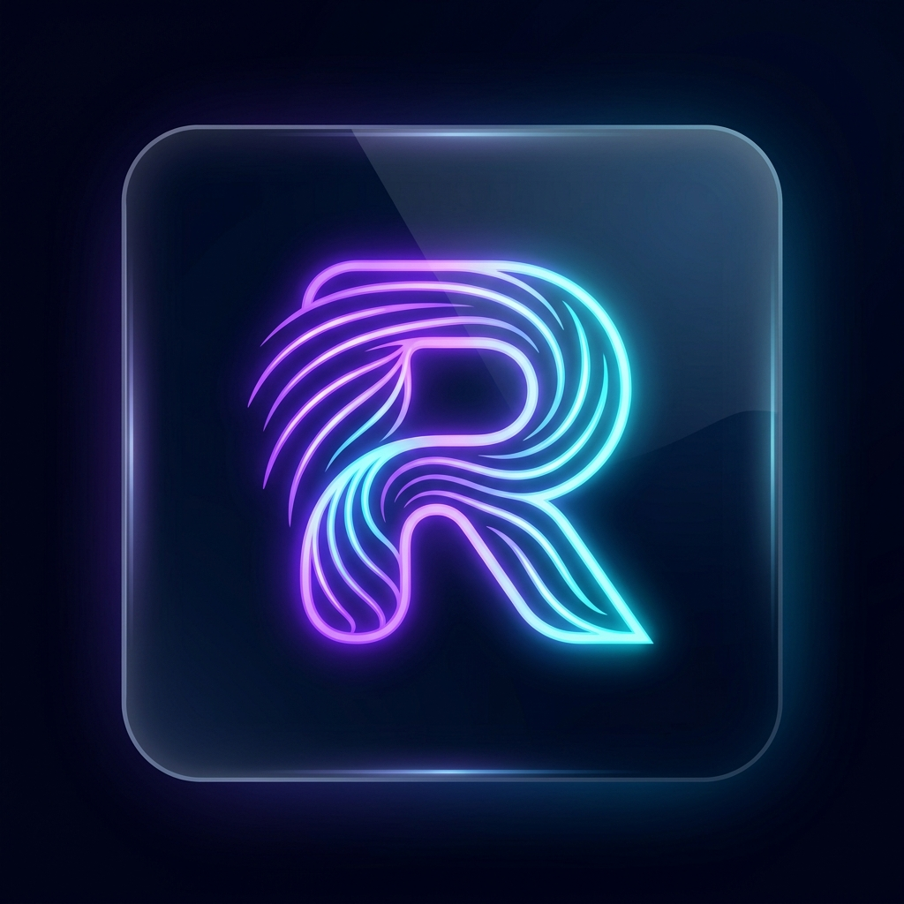

# Resono Live

### Next-Gen Music Discovery, Artist Live Streaming & Interactive Social Audio Ecosystem
*(Powering the Consumer Platform **VibeSwipe**)*

  <b>Resono Live</b> is a full-stack, cross-platform audio entertainment ecosystem connecting independent musicians with active music discovery enthusiasts through high-fidelity live streaming, gesture-driven track previews, and community discussions.

---

## 🏛️ Engineering Provenance & Production Deployment

> ### 📱 Verified Commercial Production Release
> - **Google Play Store (Live):** [VibeSwipe on Google Play Store](https://play.google.com/store/apps/details?id=com.vibeswipellc.vibeswipe)
> - **Apple App Store (Status):** Currently in submission and under active App Review with Apple Developer Relations.
> - **Client Organization:** VibeSwipe LLC
> - **Principal Architect & Lead Engineer:** **Muhammad Ali**

### 💡 Architectural Decoupling & Naming Rationale: Resono Live vs. VibeSwipe

A deliberate distinction exists between the consumer-facing trademark and this engineering repository:

- **Consumer Application (`VibeSwipe`):** The published retail brand packaged for listeners and casual discovery, emphasizing fluid, vertical-swipe musical track auditioning.
- **Underlying Engine (`Resono Live`):** Named from the Latin *resonare* ("to resonate"), this codebase houses the core, white-label audio streaming infrastructure, Agora WebRTC live broadcast channels, artist monetization ledger, and real-time gesture telemetry. Decoupling the architectural repository under **Resono Live** ensures the core real-time engine remains clean, modular, and unencumbered by localized client marketing naming constraints.

---

## 🌟 Executive Overview & Core Features

Resono Live reimagines how indie artists connect with their audience. Instead of passive playlist algorithms, listeners actively explore new talent through a fluid swipe discovery deck, while artists can broadcast high-definition live sessions, monitor track performance metrics, and monetize their work directly.

### 🎭 Two Unified Roles

1. **Listener & Discovery Mode:**
   - **Tinder-Style Audio Discovery:** Swipe left to pass, swipe right to save, swipe up to view full lyrics, artist backstory, and upcoming live broadcast schedules.
   - **Real-Time Interactive Rooms:** Join low-latency live audio rooms via Agora RTC, interact with real-time chat, and send virtual artist gifts.
   - **Custom Playlists & Favoriting:** Offline caching and real-time syncing across mobile devices.

2. **Artist & Creator Studio:**
   - **Live Audio Broadcasting:** One-tap studio streaming with virtual mixer inputs, noise suppression, and audience analytics.
   - **Track Analytics Dashboard:** Track skip rates, listener completion ratios, listener geographical distribution, and engagement heatmaps.
   - **Direct Fan Payouts:** Integrated Stripe Connect rails for real-time artist payouts and listener tipping.

---

## 🛠️ Complete Technology Stack

| Domain | Technology | Implementation Detail |
|---|---|---|
| **Mobile Client** | Flutter 3.x / Dart 3.x | Custom physics swipe cards, audio visualization shaders |
| **Real-Time RTC** | Agora RTC Engine | Low-latency (sub-200ms) multi-participant live voice streaming |
| **Backend API** | Python 3.11+, FastAPI | Asynchronous stream signaling, tip transaction verification |
| **Database** | Cloud Firestore | Real-time chat messages, active room presence, listener counts |
| **Storage & Media**| Firebase Cloud Storage | High-bitrate audio lossless uploads and CDN streaming |

---

## 🏛️ Engineering Provenance

Architected, engineered, and maintained by **Muhammad Ali** as Principal Mobile Architect.
